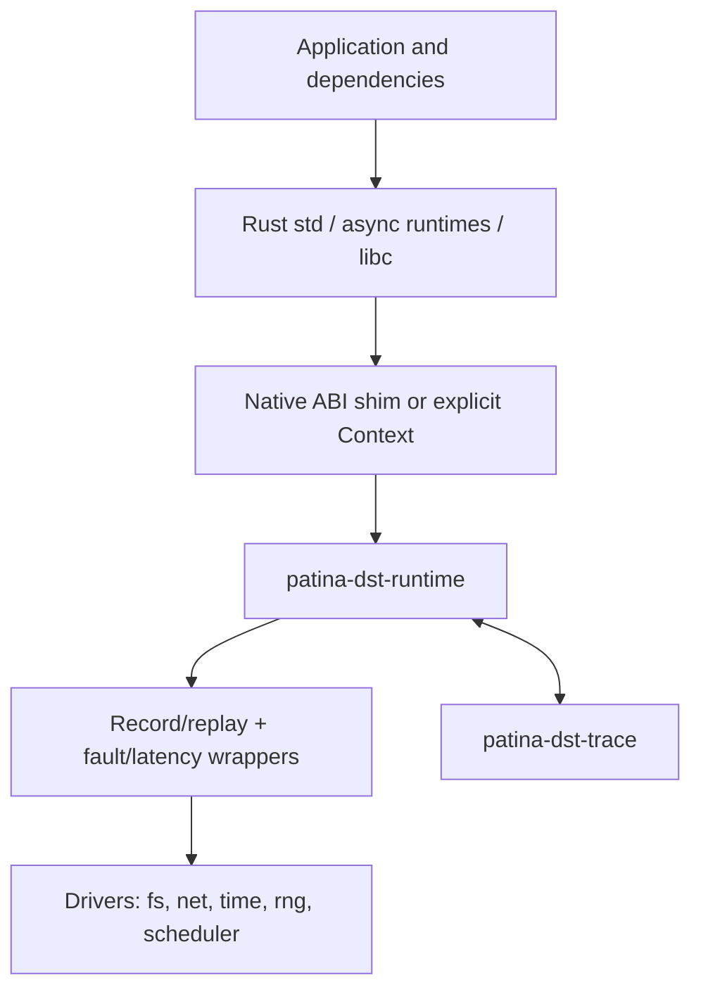

# Patina Architecture

Patina is a deterministic OS personality for Rust. `patina` builds a
program for a Patina target, routes its platform effects through a
deterministic boundary, installs virtual drivers, wraps them with
record/replay and fault behaviour, and runs the program under a deterministic
scheduler. This document is how the system fits together and the invariants a
change must keep; the code holds the detail, [VALIDATION.md](./VALIDATION.md)
the guarantees and known gaps, [docs/SCOPE.md](./docs/SCOPE.md) the rules for
new surface, and
[`crates/patina-target/ESCAPE-CLASSES.md`](./crates/patina-target/ESCAPE-CLASSES.md)
the escape taxonomy.

## System shape



Three planes:

1. **Data plane:** small effect-level interfaces (`patina-dst-abi`,
   `patina-dst-driver-api`): typed operations and outcomes, not service models.
2. **Construction plane:** typed Rust builders configure concrete drivers
   (`SimNet::builder()`, `CrashFs::builder()`, `RuntimeBuilder::with_*`).
   Topology is code, not a configuration language.
3. **Experiment plane:** the CLI and runtime parameters: seed, budget, record
   and replay, host-capture allowlists (`--mount`), fault and buggify knobs,
   exploration policies, liveness oracles and `--param` values.

## Families

One CLI serves every family; all of them drive the same runtime, drivers and
trace format.

- **Native (linked shim).** The primary family. The guest is compiled with
  the stock host target and prebuilt `std`, and the native ABI shim is linked
  statically beneath it. Strong shim definitions of the libc, pthread,
  dispatch and `syscall` surface route what `std` and C dependencies call into
  the runtime. Real host threads run one at a time under the scheduler's
  baton. On x86_64 Linux, syscall-user-dispatch (SUD) traps inline syscall
  instructions into the same entry points, and the timestamp-counter trap
  answers `rdtsc`/`rdtscp` from the virtual clock.
- **Go.** `patina build <DIR> --go` (Linux) links a Go main package
  externally (`CGO_ENABLED=1`, `-linkmode=external`) with the same shim
  objects, so goroutine threads start through the shim's `pthread_create`.
  Every Go guest carries a compute meter (`crates/cargo-patina/src/go_build.rs`,
  `c/patina_go_meter.c`): libFuzzer comparison hooks hand batches of work to
  `patina_compute_point`, which charges virtual time and takes a scheduling
  point. A metered run defaults `GOMAXPROCS=1`. The same instrumentation keeps
  Go's 8-bit edge counters, which the meter registers with the shim
  (`patina_coverage_register_u8`), so a Go guest has edge coverage
  (`--coverage-out`, campaigns, `--guided`) without the Rust/C edge
  hook. Go records no pcs, so the covmap gives its edges the zero (unknown)
  site and `patina coverage` attributes each to its package by the
  counter's `<package>..stmp_N` symbol.
- **Python.** `patina build <SCRIPT.py|DIR> --python` builds CPython
  statically by a fixed recipe (`crates/cargo-patina/src/python_build.rs`):
  every extension module in `libpython`, none needing a library the recipe
  does not build, and the C library functions the shim has no model for
  hidden from `configure` by reasoned group, a recipe test failing once the
  shim serves one. The pinned release is fetched once, checked against its
  digest and cached with its build. The built interpreter compiles the
  standard library, the application and its `--python-path` roots to
  bytecode (`python/freeze.py`), which the executable embeds; the launcher
  (`python/launcher.c`) hands them to an isolated interpreter as frozen
  modules, so a run imports nothing from a filesystem and the audit sees all
  of CPython's imports. CPython is compiled with comparison instrumentation,
  whose hooks (`python/meter.c`) hand batches to `patina_compute_point`, as
  the Go meter does: a thread computing without calls still lets the GIL
  change hands and timers come due. The Python SDK (`python/sdk/patina`) is
  frozen with each application over `_patina` (`python/sdk_module.c`), a
  builtin module the launcher registers, which lowers sites, verdicts and
  lifecycle markers to the shim's `patina_*` entries as the Go SDK does.

## Crate layout

Package names are `patina-dst-*`; directories under `crates/` drop the
`-dst-`.

```text
cargo-patina                # the CLI: the `patina` binary (and the same tool as `cargo patina`)
patina-dst (crates/patina)  # cooperative-SUT SDK (dependency-light)
patina-dst-macros           # the SDK's proc macros
patina-dst-abi              # boundary operations/outcomes, time-model constants
patina-dst-runtime          # Context, drivers, scheduler policies, record/replay, params
patina-dst-trace            # trace bundle, strict replay
patina-dst-target           # target metadata, import audit, instruction scan
patina-dst-syscalls         # syscall registry (generated identities + support)
patina-dst-conformance      # host-oracle syscall scenarios (unpublished)
patina-dst-driver-api       # driver traits
patina-dst-fs-mem           # in-memory filesystem
patina-dst-fs-crash         # crash-consistency filesystem model
patina-dst-net-sim          # virtual network (datagrams + TCP)
patina-dst-rng-seeded       # SplitMix64 and seed derivation
patina-dst-wrapper-fault    # fault-injection wrapper drivers
patina-dst-native-shim      # libc/pthread/dispatch/syscall interposition + SUD
```

```text
abi -> driver-api -> concrete drivers
abi -> trace
concrete drivers + trace -> runtime -> native-shim -> cargo-patina
```

The native shim depends on the runtime boundary; it never redefines it.

## Native build and link

### The shim build

The shim must be compiled by the exact rustc that compiles the guest, and an
installed `patina` has no source checkout. Its build script therefore
embeds the shim's workspace dependency closure (found through each crate's
`links` metadata) and its `Cargo.lock`. At guest-build time the bundle is
unpacked into a per-user cache (`$XDG_CACHE_HOME/patina`, else the platform
cache dir; `PATINA_SHIM_TARGET_DIR` moves the shim build). Cache rules:

- entries are content-addressed, published by rename, and trusted only after a
  completion marker written last; `rm -rf` of the cache is always safe between
  builds;
- each catalog has one lock; a take touches the entry's `.used` marker under
  it, and pruning removes only entries idle for a day;
- guest links read only published `artifacts/` entries, never Cargo scratch
  state;
- every patina Cargo build holds `.patina-build.lock` in its target
  directory from before Cargo runs until it has read back what it consumes.

Both halves of a link use the guest's verified concrete compiler: the build
resolves the guest's `rustc -vV` identity to an absolute sysroot binary and
uses it for every probe and build, refusing on mismatch rather than falling
back to an ambient toolchain. The injected `CARGO_ENCODED_RUSTFLAGS` carry a
hash of the link inputs, so a changed shim relinks the guest and an unchanged
one stays a cache hit. Final links keep the symbol table (`-C strip=none`),
which the audit reads.

### The sealed shim

A guest links two objects (`crates/cargo-patina/src/seal.rs`), on Linux and
Darwin alike:

- the **engine**: the shim archive linked relocatably into one object
  (`seal/elf.rs`, `seal/macho.rs`), with each Rust door renamed
  `patina_impl_<name>`, a door's `dlsym` route alias left undefined under
  the door's name, and every other global made local;
- the **façade**: the POSIX C object plus one thunk per Rust door that
  tail-jumps to `patina_impl_<name>`.

On ELF both objects take a **fixed footprint** (`seal/footprint.rs`), because
the guest's own code and data follow the shim's in the final link and a guest
observes its addresses: Go hashes pointers, so a moved type descriptor
reshapes a map and the comparisons the compute meter charges, and with them
virtual time. Each loaded kind of section (code; read-only data and exception
tables; relocated read-only data; data; zeroed data; thread-local data) is
merged into one section of a class size (the least 2^k or 3·2^(k-1) above what
it holds) at a fixed alignment. The unwind table's FDEs and the absolute
pointers (each a dynamic relocation in a position-independent guest) are
padded to class counts. The objects' references to their own definitions load
from private slots instead of GOT entries. The seal checks the result and
refuses a section it has no kind for. So a guest moves only when the shim
crosses a class. What stays variable is the shim's interface, which a guest
links by name: dynamic symbols, the host imports' PLT and GOT entries and copy
relocations, shared COMDAT groups, init and fini arrays, notes, the
static-sites table, and the distinct CIEs the final link merges. The count
assumes the seal's `ld` is GNU's, which strips FDE padding as GNU's final
link would; an LLVM-sealed object linked by GNU `ld` loses padding the
count includes. The helper
objects a build adds (allocator routing, the Go meter, the coverage stubs)
and Mach-O guests are outside the footprint.

A door therefore has one public address, whether the guest or `dlsym`
reaches it. Engine code never reaches a door: every other reference it makes
to a door's name (`std`'s I/O, locks, entropy and panic machinery, and what a
workspace crate does through them) is bound to a **host binding**, a stub the
seal links into the engine that jumps through a slot holding the host's
definition. The shim fills every slot first thing at startup, before any guest
code or signal handler runs, so no stub resolves anything and a signal handler
may take any of them; a call through a slot the host left empty is a named
fatal. A door's own code naming another door is refused. The
seal is also a gate: it refuses an engine whose
exports differ from the registry inventory and the `patina_*` ABI, a row both
or neither side defines, workspace code naming a host symbol the audit would
call an escape, and any raw syscall or counter read in the engine. Its scan
covers every executable section and refuses undecodable bytes.

The engine carries its own copy of `std`: a shim panic runs the engine's hook,
never the guest's `set_hook` or `catch_unwind`, and its once-cells and locks
wait on the host, so none may be held across a scheduling point. The two-copy tests
(`tests/native_workloads/two_copy.rs`) pin what must hold across the copies.

The C seams that stay in C are frames Rust must not own: acting cancellation
and thread exit, guest callbacks and nonlocal exits, emergency fatal paths,
guest-fault stores, clock stores and host-resolution vehicles. New doors must
satisfy the export guard and extend the ABI acceptance cases.

### Allocator routing

The link wraps Rust's four allocator entry points (`--wrap`) and links a jump
object (`cargo-patina/c/patina_allocator_routing.S`, names generated from the
shim archive by `cargo-patina/src/allocator_routing.rs`). An allocation made while the shim owns the
thread comes from the shim's arena (`patina-native-shim/src/arena.rs`, one
region at a fixed address); any other goes to the guest's allocator. A block
is freed by the allocator whose range holds it. Darwin's linker has no
`--wrap`, so there the runtime shares the guest's heap.

## Enforcement

Patina fails closed. Before a native guest runs:

- a **default-deny import audit**: every resolved symbol is interposed,
  effect-free, or explicitly `--allow`ed (`patina audit` reports what
  `run` enforces); it is version-aware, refusing GLIBC-versioned imports that
  bypass an interposer;
- an **instruction scan** for raw syscall, counter and entropy opcodes,
  thread-pointer writes, i386 entries and far transfers; raw syscalls and
  `rdtsc`/`rdtscp` are downgraded to SUD- and TSC-trap-managed only with the
  shim marker and a live platform probe, and the downgrade is reported;
- a **pre-constructor check** (ELF): the preinit array holds only the shim's
  entry; anything else is `early-init`. `ET_REL` inputs are refused.

At run time: deny-trap interposers (the process-spawn family, `dlopen`/`dlclose`) abort
by name if reached; a SUD-trapped row marked `Trap` aborts by name; on Linux
`dlsym` answers the shim's own definitions (`src/posix/dlsym.rs`) and NULL
otherwise; replay refuses fingerprint and operation mismatches.

Explicit escape hatches: `cfg(patina)`/`cfg(dst)` replacement code,
`--allow SYMBOL|all` (loud, recorded), and host capture
(`--mount`: read-only, allowlisted, fingerprinted by contents and metadata).

## Native runtime

### Startup order

On Linux the shim prepares the process from the executable's
`.preinit_array`, before any constructor: SUD, the counter trap, the rseq
takeover, the fault front, the seeded `AT_RANDOM` and the scrubbed auxv (a
static binary is prepared by the `__libc_start_main` door). The entry also
proves at run time that it is the array's only entry. The packaged
constructor then installs the runtime. Code before installation runs with the
traps armed; an effectful interposed call fails closed with a ctor
diagnostic, and `getenv` answers NULL.

### Control plane

These concerns are kept out of the interposed data plane:

- **Trace channel.** The supervisor passes an inherited host descriptor
  (`PATINA_RT_TRACE_FD`); the shim reads and writes bundles through private host
  aliases, never through the interposed file symbols.
- **Captured stdio.** Descriptor 0 is an empty pipe at startup; `--stdin
  FILE` makes it instead an unlinked read-only regular file of FILE's bytes,
  made at install with no fault drawn. The trace records the bytes, capped,
  and replay restores them. Its reads are filesystem
  reads, so they fault like any file's.
  The descriptions 1 and 2 name at startup are capture
  sinks; on Linux each write also goes through to the host descriptor. The
  numbers are ordinary descriptor-table entries; runtime diagnostics write to
  the sinks directly. C stdio is the shim's (`src/posix/stdio.rs`): one
  stream table holds `stdin`, `stdout`, `stderr` and every stream
  `fopen`/`fdopen` opens, with the platform libc's buffering, read-ahead and
  indicator rules (glibc's on Linux, the BSD stdio's on Darwin) over the
  modeled descriptor calls. Every refill and flush is a guest read or write,
  so faults reach it and replay reproduces it; each stream's lock is a
  modeled guest mutex. Any other `FILE*` (a stream a host library made for
  itself) stops by name.
- **Environment.** The supervisor clears the ambient environment; the shim
  snapshots the private control plane before erasing it. `--env` supplies the
  guest's startup map, written into reserved initial-stack slots; the trace
  records it. After startup the environment is guest memory
  (`src/posix_env.rs`), reproduced by re-execution, not recorded. `--cwd` and
  the umask work the same way; the working directory is held as a node.
- **Knob resolution.** The supervisor passes the run's settings as
  `PATINA_RT_*` variables (`patina_dst_runtime::RUNTIME_ENV_PREFIX`; each is an
  `ENV_*` constant there, with its meaning), plus inherited descriptors for the
  trace, facts, stop record, reports and coverage. They are internal: `patina
  --help` does not list them, and an inherited one is stripped. Every knob is
  resolved once, at configuration time. The runtime never reads the process
  environment after installation.
- **Address layout.** The supervisor launches every incarnation so the kernel
  picks the same addresses (`src/native_run/layout.rs`): ASLR off for the
  image (`ADDR_NO_RANDOMIZE`; Darwin `_POSIX_SPAWN_DISABLE_ASLR`), the modeled
  8 MiB stack limit, and an initial stack padded to one size in every mode.
  The sealed shim's fixed footprint (above) keeps the image's own layout
  from following the shim's contents.
  The shim verifies the layout at installation and stops by name if the host
  ignored it. `--allow-randomized-address-layout` opts out, qualifying the
  run; every trace records `address_layout`, `patina replay` launches with
  the recorded one, and the runtime reconciles it both ways. The shim answers memory calls on its arena region as for unmapped
  space.

### Scheduling, waits and signals

- Lock order is ThreadRuntime → context slot. Host signal-frame release never
  holds either lock.
- Every interruptible park registers one wait (`Wait::enqueue` is the only way
  onto a `WaitQueue`), with one removal path shared by wake, resume, expiry
  and thread exit. Expiries are settled at every acquisition of the thread
  runtime; the wake funnel refuses a wake that meets unsettled expiries.
- While the thread runtime is held, Context calls run as an embedder section
  in which virtual time stands still.
- The scheduler picks uniformly among the runnable tasks; under PCT
  (`--sched-pct`) it picks the one of highest priority. A task PCT has
  picked at 1024 decisions in a row over a runnable peer is moved below every
  other task, whatever it did between them, so a task spinning until a peer
  acts lets that peer run under every schedule.
- Signal dispositions and shared pending signals are per process; masks and
  private pending signals per task. Generation records `SignalGenerated`;
  delivery runs on the recipient task under the baton.
- On Linux every host handler the shim owns runs `SA_ONSTACK` on a guarded
  shim-owned private stack (`src/thread/signals/frames.rs`), so the kernel
  never builds a frame on a guest stack (its size is host-CPU dependent).
  Guest handlers run on the stack their action asks for, chosen by 6.8's
  `get_sigframe` rules.
- The syscall and counter traps deliver from the C driver
  (`c/posix/delivery.c`), between returning Rust steps; libc doors still
  deliver from Rust (see VALIDATION.md, known gaps).
- An internal stop is the host's default SIGABRT, never a delivery. Shim
  fatal paths use private abort vehicles and leave the trace incomplete.
- A shim call of its own boundary (e.g. std's futex through `syscall(2)`
  beneath a dispatch) is a named stop; the shim's `clippy.toml` refuses the
  spellings that lower to one.

### Models

The Linux kernel personality is Ubuntu 24.04's 6.8 kernel and glibc 2.39
(`VIRTUAL_ABI`). One model serves each object, behind both the libc doors and
the SUD rows: a door never decides by kind itself.

- **Descriptors** (`src/fdtable.rs`): one kernel-shaped table, lowest-free
  numbers referencing open descriptions; `patina_fd_kind` is the one oracle
  for kind-dependent calls. Guest numbers are never recorded.
- **Filesystem:** the driver (`MemFs`, `CrashFs`) behind the descriptor
  funnels; procfs (`src/procfs/`), memory devices (`src/memdev.rs`),
  nsfs (`src/nsfs.rs`) are typed virtual
  entries every path operation answers. procfs's content is the shim's,
  made from state only the shim holds, but its opens and reads are the
  driver's decisions (`FsDriver::open_synthetic`, `read_synthetic`): the
  trace holds them, and the fault wrapper fails them only as procfs fails
  (`ENOMEM`) and shortens its reads.
- **Sockets** (`src/thread/net.rs`): `patina_sock_*` entries over `SimNet`
  (INET) and the shim's own AF_UNIX/netlink; guest memory goes through
  `uaccess` (`EFAULT`, never a shim fault).
- **Memory** (`src/mem/`): anonymous memory is host address space; file
  mappings are views of a page cache held in a host memfd (an unlinked file on
  macOS), synchronized at the descriptor funnels.
- **Time and timers** (`src/clocks.rs`, `src/thread/timers.rs`), **identity
  and credentials** (`src/identity.rs`: uid/gid 1000, no capabilities; init
  is root), **privileged rows** (`src/sud/privileged/`: the kernel's checks
  in order, then a capability refusal, or a named stop), **limits**
  (`src/limits.rs`), **IPC** (`src/thread/ipc.rs`).

Every answer is a function of recorded decisions and modeled state; what the
model does not answer is a named stop, never a host passthrough.

## Virtual time

- The clock starts at a fixed uptime (`DEFAULT_BOOT_ORIGIN_NANOS`) and a fixed
  realtime epoch (`DEFAULT_REALTIME_EPOCH_NANOS`, `--realtime-epoch`), which
  every trace records.
- Exactly two things move it: **idle time** (a sleep advances to its
  deadline; when every task is parked the rescue advances to the earliest
  deadline) and **charged work**: every guest call is charged once by its
  `ChargeClass`, and the clock follows each charge, stopping at the earliest
  pending deadline. Charges are derived, not recorded; replay re-derives
  them.
- One authority expires timed parks, after every advance and at every
  timed-park registration, in `(deadline, registration)` order.
- **Computation costs time.** In an instrumented build (the default for
  Rust and C; `--no-instrument` builds plain)
  every edge is a compute unit (`ChargeClass::Compute`, 2 ns of user time).
  Each thread counts its own edges and hands them over in batches of 16384,
  so a batch falls at the same edge on every run and an operation's
  timestamp lags the computation before it by at most one batch. A Go
  guest's comparison meter and the Python meter charge the same way. Only
  the edges counted move time: host speed never does. Only guest code is
  counted: the shim pauses the meter while it owns the thread (its own
  allocations through an instrumented guest allocator differ between record
  and replay), and the count restarts when the runtime is installed. Edge
  counts are a property of the binary: another platform's or compiler's
  build of the same source counts differently, so virtual time, like a
  trace, is reproducible per build.
- **One virtual CPU.** Charges from every thread add to one total, and the
  compute budget and the no-progress horizon count it whichever task
  computed: tasks take turns on one virtual CPU, so two spinners reach a
  bound together as one does alone.
- **Slices.** At a batch, the charged time moves the clock (expiring the
  parks it reaches), and once the running task has computed 1 ms of CPU time
  since it was selected and another task is runnable, it takes a scheduling
  point. A spinner beside a sleeping peer therefore lets the peer's deadline
  arrive and the peer run, with no `--yield-stride`. A batch that takes no
  scheduling point still delivers a signal its time made due, so a lone
  computing thread receives its alarm (Linux: the macOS shim models no
  timer signals). A slice can end inside
  instrumented code that holds a host lock Patina does not model (a C
  library's internal lock around a callback); a peer that then blocks on
  that lock in the host holds the run still, and the observer's wall-clock
  backstop (below) ends it as an inconclusive `compute-bound` stop.
- **Polling costs time.** A poll is a clock read, an operation that found
  nothing to take, or a `sched_yield` with no progress and no metered
  computation by any task since the previous `sched_yield` by any task (two
  tasks yielding to each other poll; a backoff beside a computing peer does
  not). The
  runtime cannot tell a guest that polls toward a time of its own from one
  that works and reads the clock as it goes, so the cost of a poll depends
  only on how long the guest has done nothing but poll, never on what
  deadlines are pending. After 1024 polls with no progress and no idle wait
  in between (a streak), the call that completes the count is also charged a
  token: 1 µs, doubling to 1 ms, and once the streak has charged a quarter
  second, 1/256 of what it has charged. The clock follows that charge like
  any other, stopping at each pending deadline on the way; only a CPU-time
  timer caps it.
- What that means for a guest: a burst of up to about ten thousand polls
  costs little more than the calls themselves; a busy-wait on the clock
  reaches its own deadline late by at most 1 ms or 0.4% of the wait (a minute
  away in 1.7 million polls); and a long streak grows virtual time
  geometrically, so a million clock reads with no other effect cost about
  4 s. A peer's timeout passes during a streak only once the streak has
  itself charged that long.
- **The no-progress horizon.** CPU time charged since the run last made
  progress (an operation that is not scheduling, time or an empty poll)
  reaching the no-progress budget stops the run with
  `liveness detail=no-progress`. The budget is `--liveness-watchdog`'s, else
  10 virtual minutes; replay adopts the recording's. Only charged time
  counts, never an idle advance, so a guest that sleeps or waits never
  reaches it however long it waits, and one that spins, polls or yields with
  nothing happening does, whatever it spins on: a clock loop in about 2.3
  million polls, a computing spinner beside a periodic sleeper after the
  budget's worth of edges. The stop says what was seen, not that the loop
  could never end: a busy-wait toward a time further off is stopped the same
  way, and so is a computation that runs longer than the budget with no
  operation that makes progress (raise `--liveness-watchdog` for one). PCT
  (`--sched-pct`) may defer a runnable task for about a virtual second of a
  spinner's slices, so a budget, or a compute budget, set below that can
  stop a spin-wait whose setter it is still deferring.
- CPU time is the sum of charges (`cpu_charges` in the facts). A call-free
  loop in a build with no meter is charged nothing.
- Every trace records `time_model` (`TIME_MODEL`); a trace from another model
  is refused. A change to what moves time bumps that number.

### Compute bounds

Computation that makes no call reaches the runtime only through its meter.

- **Metered (instrumented, Go, Python).** Metered computation charged with no
  guest call and no operation but scheduling points in between, by any
  task, reaching the compute budget
  (`--compute-watchdog-ms`, default 10 s, read as virtual time) stops the run
  as `timeout` with reason `compute_bound` (`PATINA_STOP compute_bound`, a
  `compute_bound` finding with `known_limit` false). The budget is recorded,
  and replay derives the same stop at the same edge. A computation shorter
  than the budget completes on any host, however slow; one that needs longer
  raises the budget.
- **Unmetered (a plain build).** Code that makes no call cannot hand over the
  baton, and nothing it does moves virtual time. A host observer, started
  with the runtime, stops the run after `--compute-watchdog-ms` of wall time
  in which the guest was charged no virtual time and began no boundary
  operation, with `PATINA_VIOLATION liveness detail=compute-bound
  known_limit=true` (the `timeout` outcome, attributed to Patina, and
  inconclusive), and tells the user to rebuild without `--no-instrument`. It
  watches whichever thread runs guest code: a task with runnable or parked
  peers, and the main thread of a guest that never starts another (in a
  `patina build` guest; another embedding starts the observer with its first
  thread). In a metered build every batch is a charge, so the observer only
  sees code its meter does not count, and measures its window in the
  process's CPU time, which a slow, loaded or stopped host does not advance.
  A guest that burns no CPU there (blocked on the host) never fills that
  window, so wall time also bounds it: the stamp standing still for ten times
  the bound, still so one look later, stops the run whatever CPU it used: once a host stall ends, a metered guest charges its next batch
  within microseconds. The observer never preempts, wakes,
  advances time or feeds a host answer to the guest. The trace records
  `compute_stop`; replay consumes the prefix and stops at the same point. The
  observer then samples the interrupted PC best-effort. Its helpers use only
  the `HostApi` table, block all signals, allocate nothing and only try-lock
  runtime locks.

## Drivers and wrappers

Concrete drivers implement capabilities: `MemFs`, `CrashFs` (an ext4-style
journal: commits, delayed allocation, torn in-place overwrites),
`SimNet`, `VirtualClock`, `SeededEntropy`, `DetScheduler`. Wrapper drivers
compose around them (`FaultFs`). Record and replay live at the runtime
boundary, not in drivers, so they compose with any driver stack. Every
`Context` has every driver: a slot the builder is not handed gets the
standard one.

Crash restart (`--machine-crash-permille`, `--process-crash-permille`, native
only): a crash point exports the
`FsSnapshot`, the shim hands it to the supervisor, and a fresh incarnation
boots from it; see [docs/crash-restart-protocol.md](docs/crash-restart-protocol.md).

## Trace model

A trace records decisions, not outputs: scheduler choices, time advances,
entropy, network and filesystem fault decisions, permitted host responses. A
`.patina` bundle holds run metadata and the run's timeline (`main`, with
lifecycle markers for crash restart).

- **Strict replay:** matching fingerprints and the same boundary events, or an
  error. A replay reaching an unrecorded host effect fails; there is no
  record-on-miss.
- **Fingerprints** describe the run that happened (swarm masking strips the
  components it dropped). A seeded run writes no trace and takes no
  fingerprint label.
- **Native identity** (`metadata.native`): `executable_sha256`, the
  libraries, the admitted programs and `supervisor_sha256` are compared on
  replay and refused as `fingerprint_mismatch`; the version, shim bundle,
  target and each admitted program's artifact path are context only.
  Campaigns pin both digests, and child processes refuse to run as a
  different supervisor build. Child process groups die with their parent
  (`src/lifeline.rs`).
- **Admission.** A guest may spawn only itself and its package's own
  binaries. `patina test` builds each `[[bin]]` of the selected packages
  shim-linked, stages it at `target/patina/dst/PACKAGE/programs/BIN`, judges
  it once with the pre-run gate (a binary that does not build or stage, or
  two selected packages installing one path, is refused with the reason),
  and hands each test's `patina run` its package's verdicts and digests,
  keyed by the path `CARGO_BIN_EXE_<bin>` names; a listing run gets none.
  The run adds the guest itself under the path it was given and its
  canonical path (the guest observes no path of its own: `argv[0]` is fixed
  and `/proc/self/exe` is absent; a guest built on the fly is not admitted).
  The supervisor holds the table (`src/native_run/admission.rs`): it keeps
  each admitted artifact open for the run and confirms the open file's
  digest (staging replaces by rename, so the open file keeps the audited
  bytes), and tells the shim only what each path is (`PATINA_RT_ADMIT`):
  admitted with an artifact id, refused with the reason, or missing. A
  recording names each program but the guest by path, digest and verdict; a
  replay judges each artifact again under its own `--allow` and refuses a
  changed digest or verdict, while an artifact that is gone refuses nothing
  until a spawn reaches it. The keys are absolute host paths, so a recording
  that names programs is byte-identical per checkout. Admission covers
  `posix_spawnp` and `pidfd_spawnp` only, matched exactly (no `PATH`
  search): a spawn of an admitted program still stops as `not_modeled` until
  multi-process runs land, any other spawn is refused (`deny_trap`), and
  `fork` and the exec family (a `Command` that falls back to them included)
  are refused as before.
- **One format version** (`TRACE_FORMAT_VERSION`); other versions are refused,
  never upgraded.
- **A liveness stop is recorded.** The watchdog's stop flushes the recording
  as it aborts, and a replay adopts the recorded watchdog (whatever
  `--liveness-watchdog` it is given) and keeps PCT's state as the recorded
  decisions left it, so it reaches the same stop at the same operation.
- **Bounded:** a trace is held whole by the recorder, the supervisor that
  commits it and a replay, at about 256 bytes an event, so it is limited to
  `MAX_TIMELINE_EVENTS` (4,000,000) and `MAX_TRACE_BYTES` (256 MiB). Past
  either, the recorder drops what it holds, writes an abandoned-trace marker
  and reports `PATINA_INFRA trace=incomplete`. Recording is write-only, so the
  run goes on to the outcome it would have had unrecorded, and its result
  carries `trace_incomplete` beside that class. Every other finalization
  failure fails the run.

## Host-alias doctrine

The shim is linked into the guest, so any host symbol the shim names appears
in the guest's import table, where an allowance would also cover the guest's
own use. Therefore **shim code never names a public, interposable host
symbol.** Every host vehicle (trace-fd I/O, the baton semaphore, thread
creation) is resolved once by string into the `HostApi` table
(`patina-native-shim/src/host.rs`): `dlsym(RTLD_NEXT, …)` on macOS, and on
Linux through `__real_dlsym` (`--wrap=dlsym`), since the shim interposes
`dlsym` there. Internal vehicles use the canonical platform primitive;
avoiding a name is never a reason to choose another. The seal enforces the
rule statically on every build; `dlsym` is the only control-plane import.

## Cooperative-SUT SDK

`patina-dst` (`crates/patina`) provides `buggify!` and friends, the
`always!`/`sometimes!`/`reachable!` oracles, `verdict()`, `param()`, `rng()`
and lifecycle markers. They bridge to the runtime only under
`cfg(patina_shim)`, injected by native builds; elsewhere they are no-ops, so
a plain `cargo build` links no runtime. Buggify randomness is a pure function
of the seed and the site label, never recorded per evaluation; the realized
config lives in the trace's `buggify` metadata and folds `+buggify` into the
fingerprint. Literal-label sites emit a link-time site table the shim reports
before execution. One SDK declaration generates every site macro.

### The verdict ABI

One verb, `patina_verdict(kind, label, detail)` (`Context::verdict` in
process): `kind` is a closed enum (`VIOLATION`, `PASS`, `ABORT_INTENT`), an
unknown kind is refused, and `label` shares the site namespace without
registering a site. Each call is a recorded operation. A `VIOLATION` or
`ABORT_INTENT` rewrites the run's `patina.runfacts/v1` document at once, so
it survives the abort that follows. An `always!` violation lowers to a
`VIOLATION` verdict.

## Syscall registry and conformance

`patina-dst-syscalls` is a dependency-free metadata crate: a checked-in
generated table of the compiled target's identities (Linux x86_64, Linux
aarch64, Darwin aarch64; `Syscall::number()` is total), reviewed Linux
support (`linux.rs`) and the libc surface (`symbols.rs`). SUD handler bindings
are keyed by those IDs with compile-time checks. A maintainer generator
refreshes the table; normal builds never fetch or parse upstream sources. A
number newer than `VIRTUAL_ABI` is `Absent` (`ENOSYS`).

`patina-dst-conformance` holds scenarios as plain functions in one probe
binary; `crates/cargo-patina/tests/native_conformance.rs` runs each natively
(the host kernel is the oracle) and under patina, comparing observations live
except for each scenario's declared normalizations and gaps. A scenario
declares which registry entries it covers. `patina syscalls` emits the
compiled target's `patina.syscalls/v3` inventory.

## Invariants

1. `std` and shims never reach the host directly; shim host access goes
   through `HostApi` private aliases.
2. Unsupported nondeterminism fails loudly, by name; nothing falls back to
   the host.
3. Record and replay operate at the runtime boundary, never inside a driver.
4. Core driver traits stay smaller than concrete driver builders; topology is
   code.
5. Seeds and traces are experiment-plane concerns; every run input that
   changes behaviour is recorded and reconciled on replay.
6. Virtual time moves only by idle advances and derived charges (calls,
   poll escalations and metered computation), never by host time.
7. A door has one model; libc doors and SUD rows never disagree.
8. The shim extends compatibility without defining core semantics.
9. One trace format version and one time model; old traces are refused.
