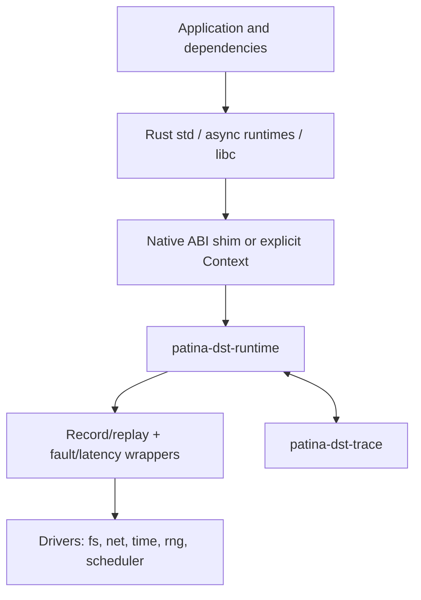

# Patina Architecture

Patina is a deterministic OS personality for Rust. `cargo patina` builds a
program for a Patina target, routes its platform effects through a
deterministic boundary, installs virtual drivers, wraps them with
record/replay and fault behaviour, and runs the program under a deterministic
scheduler. This document is how the system fits together and the invariants a
change must keep; the code holds the detail, [VALIDATION.md](./VALIDATION.md)
the guarantees and known gaps, [docs/SCOPE.md](./docs/SCOPE.md) the rules for
new surface, and
[`crates/patina-target/ESCAPE-CLASSES.md`](./crates/patina-target/ESCAPE-CLASSES.md)
the escape taxonomy.

## System shape



Three planes:

1. **Data plane:** small effect-level interfaces (`patina-dst-abi`,
   `patina-dst-driver-api`): typed operations and outcomes, not service models.
2. **Construction plane:** typed Rust builders configure concrete drivers
   (`SimNet::builder()`, `CrashFs::builder()`, `RuntimeBuilder::with_*`).
   Topology is code, not a configuration language.
3. **Experiment plane:** the CLI and runtime parameters: seed, budget, record
   and replay, host-capture allowlists (`--mount`), fault and buggify knobs,
   exploration policies, liveness oracles and `--param` values.

## Families

One CLI serves every family; all of them drive the same runtime, drivers and
trace format.

- **Native (linked shim).** The primary family. The guest is compiled with
  the stock host target and prebuilt `std`, and the native ABI shim is linked
  statically beneath it. Strong shim definitions of the libc, pthread,
  dispatch and `syscall` surface route what `std` and C dependencies call into
  the runtime. Real host threads run one at a time under the scheduler's
  baton. On x86_64 Linux, syscall-user-dispatch (SUD) traps inline syscall
  instructions into the same entry points, and the timestamp-counter trap
  answers `rdtsc`/`rdtscp` from the virtual clock.
- **Go.** `cargo patina build <DIR> --go` (Linux) links a Go main package
  externally (`CGO_ENABLED=1`, `-linkmode=external`) with the same shim
  objects, so goroutine threads start through the shim's `pthread_create`.
  Every Go guest carries a compute meter (`crates/cargo-patina/src/go_build.rs`,
  `c/patina_go_meter.c`): libFuzzer comparison hooks hand batches of work to
  `patina_compute_point`, which charges virtual time and takes a scheduling
  point. A metered run defaults `GOMAXPROCS=1`.
- **Harness** (`patina-dst-harness`, usage mode 2). A harness binary
  configures the run in code, then runs ordinary `std` code under the shim's
  global runtime. a harness binary's `PATINA_HARNESS_V1` marker makes the supervisor set
  `PATINA_RT_DEFER_INIT=1`, so the constructor
  scrubs the control plane but leaves installation to
  `patina_harness_install`. Its overlay flows through the same `PATINA_RT_*`
  values and `RuntimeConfig` fields as the CLI, so replay reconciliation
  covers it. Run without Patina, it returns `NotUnderPatina`.
  Its `.param()` values are run-parameter defaults a CLI `--param` overrides
  per key (the shim merges the two control-plane values); the guest reads the
  merged set through `patina_dst::param`, a pure configuration read, and the
  trace records it for replay.

## Crate layout

Package names are `patina-dst-*`; directories under `crates/` drop the
`-dst-`.

```text
cargo-patina                # the CLI
patina-dst (crates/patina)  # cooperative-SUT SDK (dependency-light)
patina-dst-macros           # the SDK's proc macros
patina-dst-harness          # configure-then-run harness under the shim
patina-dst-abi              # boundary operations/outcomes, time-model constants
patina-dst-runtime          # Context, drivers, scheduler policies, record/replay, params
patina-dst-trace            # trace bundle, branch metadata, strict replay
patina-dst-target           # target metadata, import audit, instruction scan
patina-dst-syscalls         # syscall registry (generated identities + support)
patina-dst-conformance      # host-oracle syscall scenarios (unpublished)
patina-dst-driver-api       # driver traits
patina-dst-fs-mem           # in-memory filesystem
patina-dst-fs-crash         # crash-consistency filesystem model
patina-dst-net-sim          # virtual network (datagrams + TCP)
patina-dst-rng-seeded       # SplitMix64 and seed derivation
patina-dst-wrapper-fault    # fault-injection wrapper drivers
patina-dst-native-shim      # libc/pthread/dispatch/syscall interposition + SUD
```

```text
abi -> driver-api -> concrete drivers
abi -> trace
concrete drivers + trace -> runtime -> async -> patina-dst -> cargo-patina
```

Native shims and the harness depend on the runtime boundary; they never
redefine it.

## Native build and link

### The shim build

The shim must be compiled by the exact rustc that compiles the guest, and an
installed `cargo-patina` has no source checkout. Its build script therefore
embeds the shim's workspace dependency closure (found through each crate's
`links` metadata) and its `Cargo.lock`. At guest-build time the bundle is
unpacked into a per-user cache (`$XDG_CACHE_HOME/patina`, else the platform
cache dir; `PATINA_SHIM_TARGET_DIR` moves the shim build). Cache rules:

- entries are content-addressed, published by rename, and trusted only after a
  completion marker written last; `rm -rf` of the cache is always safe between
  builds;
- each catalog has one lock; consumers hold kernel leases, so pruning never
  removes an entry in use;
- guest links read only published `artifacts/` entries, never Cargo scratch
  state;
- every cargo-patina Cargo build holds `.patina-build.lock` in its target
  directory from before Cargo runs until it has read back what it consumes.

Both halves of a link use the guest's verified concrete compiler: the build
resolves the guest's `rustc -vV` identity to an absolute sysroot binary and
uses it for every probe and build, refusing on mismatch rather than falling
back to an ambient toolchain. The injected `CARGO_ENCODED_RUSTFLAGS` carry a
hash of the link inputs, so a changed shim relinks the guest and an unchanged
one stays a cache hit. Final links keep the symbol table (`-C strip=none`),
which the audit reads.

### The sealed shim

A guest links two objects (`crates/cargo-patina/src/seal.rs`), on Linux and
Darwin alike:

- the **engine**: the shim archive linked relocatably into one object
  (`seal/elf.rs`, `seal/macho.rs`), with each Rust door renamed
  `patina_impl_<name>`, a door's `dlsym` route alias left undefined under
  the door's name, and every other global made local;
- the **façade**: the POSIX C object plus one thunk per Rust door that
  tail-jumps to `patina_impl_<name>`.

A door therefore has one public address, whether the guest or `dlsym`
reaches it. Engine code never reaches a door: every other reference it makes
to a door's name (`std`'s I/O, locks, entropy and panic machinery, and what a
workspace crate does through them) is bound to a **host binding**, a stub the
seal links into the engine that jumps through a slot holding the host's
definition. The shim fills every slot first thing at startup, before any guest
code or signal handler runs, so no stub resolves anything and a signal handler
may take any of them; a call through a slot the host left empty is a named
fatal. A door's own code naming another door is refused. The
seal is also a gate: it refuses an engine whose
exports differ from the registry inventory and the `patina_*` ABI, a row both
or neither side defines, workspace code naming a host symbol the audit would
call an escape, and any raw syscall or counter read in the engine. Its scan
covers every executable section and refuses undecodable bytes.

The engine carries its own copy of `std`: a shim panic runs the engine's hook,
never the guest's `set_hook` or `catch_unwind`, and its once-cells and locks
wait on the host, so none may be held across a scheduling point. The two-copy tests
(`tests/native_workloads/two_copy.rs`) pin what must hold across the copies.

The C seams that stay in C are frames Rust must not own: acting cancellation
and thread exit, guest callbacks and nonlocal exits, emergency fatal paths,
guest-fault stores, clock stores and host-resolution vehicles. New doors must
satisfy the export guard and extend the ABI acceptance cases.

### Allocator routing

The link wraps Rust's four allocator entry points (`--wrap`) and links a jump
object (`c/patina_allocator_routing.S`, names generated from the shim archive
by `src/allocator_routing.rs`). An allocation made while the shim owns the
thread comes from the shim's arena (`patina-native-shim/src/arena.rs`, one
region at a fixed address); any other goes to the guest's allocator. A block
is freed by the allocator whose range holds it. Darwin's linker has no
`--wrap`, so there the runtime shares the guest's heap.

## Enforcement

Patina fails closed. Before a native guest runs:

- a **default-deny import audit**: every resolved symbol is interposed,
  effect-free, or explicitly `--allow`ed (`cargo patina audit` reports what
  `run` enforces); it is version-aware, refusing GLIBC-versioned imports that
  bypass an interposer;
- an **instruction scan** for raw syscall, counter and entropy opcodes,
  thread-pointer writes, i386 entries and far transfers; raw syscalls and
  `rdtsc`/`rdtscp` are downgraded to SUD- and TSC-trap-managed only with the
  shim marker and a live platform probe, and the downgrade is reported;
- a **pre-constructor check** (ELF): the preinit array holds only the shim's
  entry; anything else is `early-init`. `ET_REL` inputs are refused.

At run time: deny-trap interposers (the process-spawn family, `dlopen`/`dlclose`) abort
by name if reached; a SUD-trapped row marked `Trap` aborts by name; on Linux
`dlsym` answers the shim's own definitions (`src/posix/dlsym.rs`) and NULL
otherwise; replay refuses fingerprint and operation mismatches.

Explicit escape hatches: `cfg(patina)`/`cfg(dst)` replacement code,
`--allow`/`--allow-unsupported-symbols` (loud, recorded), and host capture
(`--mount`: read-only, allowlisted, fingerprinted by contents and metadata).

## Native runtime

### Startup order

On Linux the shim prepares the process from the executable's
`.preinit_array`, before any constructor: SUD, the counter trap, the rseq
takeover, the fault front, the seeded `AT_RANDOM` and the scrubbed auxv (a
static binary is prepared by the `__libc_start_main` door). The entry also
proves at run time that it is the array's only entry. The packaged
constructor then installs the runtime. Code before installation runs with the
traps armed; an effectful interposed call fails closed with a ctor
diagnostic, and `getenv` answers NULL.

### Control plane

These concerns are kept out of the interposed data plane:

- **Trace channel.** The supervisor passes an inherited host descriptor
  (`PATINA_RT_TRACE_FD`); the shim reads and writes bundles through private host
  aliases, never through the interposed file symbols.
- **Captured stdio.** The descriptions 1 and 2 name at startup are capture
  sinks; on Linux each write also goes through to the host descriptor. The
  numbers are ordinary descriptor-table entries; runtime diagnostics write to
  the sinks directly. C `stdout`/`stderr` are the shim's (`src/posix/stdio.rs`,
  glibc's buffering rules); any other `FILE*` stops by name.
- **Environment.** The supervisor clears the ambient environment; the shim
  snapshots the private control plane before erasing it. `--env` supplies the
  guest's startup map, written into reserved initial-stack slots; the trace
  records it. After startup the environment is guest memory
  (`src/posix_env.rs`), reproduced by re-execution, not recorded. `--cwd` and
  the umask work the same way; the working directory is held as a node.
- **Knob resolution.** Every `PATINA_RT_*` knob is resolved once, at
  configuration time. The runtime never reads the process environment after
  installation. Report suppressors travel one table
  (`patina_dst_runtime::Report`) and are presentation only.
- **Address layout.** The supervisor launches every incarnation so the kernel
  picks the same addresses (`src/native_run/layout.rs`): ASLR off for the
  image (`ADDR_NO_RANDOMIZE`; Darwin `_POSIX_SPAWN_DISABLE_ASLR`), the modeled
  8 MiB stack limit, and an initial stack padded to one size in every mode.
  The shim verifies the layout at installation and stops by name if the host
  ignored it. `--allow-randomized-address-layout` opts out, qualifying the
  run; every trace records `address_layout`, and replay reconciles it both
  ways. The shim answers memory calls on its arena region as for unmapped
  space.

### Scheduling, waits and signals

- Lock order is ThreadRuntime → context slot. Host signal-frame release never
  holds either lock.
- Every interruptible park registers one wait (`Wait::enqueue` is the only way
  onto a `WaitQueue`), with one removal path shared by wake, resume, expiry
  and thread exit. Expiries are settled at every acquisition of the thread
  runtime; the wake funnel refuses a wake that meets unsettled expiries.
- While the thread runtime is held, Context calls run as an embedder section
  in which virtual time stands still.
- Signal dispositions and shared pending signals are per process; masks and
  private pending signals per task. Generation records `SignalGenerated`;
  delivery runs on the recipient task under the baton.
- On Linux every host handler the shim owns runs `SA_ONSTACK` on a guarded
  shim-owned private stack (`src/thread/signals/frames.rs`), so the kernel
  never builds a frame on a guest stack (its size is host-CPU dependent).
  Guest handlers run on the stack their action asks for, chosen by 6.8's
  `get_sigframe` rules.
- The syscall and counter traps deliver from the C driver
  (`c/posix/delivery.c`), between returning Rust steps; libc doors still
  deliver from Rust (see VALIDATION.md, known gaps).
- An internal stop is the host's default SIGABRT, never a delivery. Shim
  fatal paths use private abort vehicles and leave the trace incomplete.
- A shim call of its own boundary (e.g. std's futex through `syscall(2)`
  beneath a dispatch) is a named stop; the shim's `clippy.toml` refuses the
  spellings that lower to one.

### Models

The Linux kernel personality is Ubuntu 24.04's 6.8 kernel and glibc 2.39
(`VIRTUAL_ABI`). One model serves each object, behind both the libc doors and
the SUD rows: a door never decides by kind itself.

- **Descriptors** (`src/fdtable.rs`): one kernel-shaped table, lowest-free
  numbers referencing open descriptions; `patina_fd_kind` is the one oracle
  for kind-dependent calls. Guest numbers are never recorded.
- **Filesystem:** the driver (`MemFs`, `CrashFs`) behind the descriptor
  funnels; procfs (`src/procfs/`), memory devices (`src/memdev.rs`),
  nsfs (`src/nsfs.rs`) are typed virtual
  entries every path operation answers.
- **Sockets** (`src/thread/net.rs`): `patina_sock_*` entries over `SimNet`
  (INET) and the shim's own AF_UNIX/netlink; guest memory goes through
  `uaccess` (`EFAULT`, never a shim fault).
- **Memory** (`src/mem/`): anonymous memory is host address space; file
  mappings are views of a page cache held in a host memfd (an unlinked file on
  macOS), synchronized at the descriptor funnels.
- **Time and timers** (`src/clocks.rs`, `src/thread/timers.rs`), **identity
  and credentials** (`src/identity.rs`: uid/gid 1000, no capabilities; init
  is root), **privileged rows** (`src/sud/privileged/`: the kernel's checks
  in order, then a capability refusal, or a named stop), **limits**
  (`src/limits.rs`), **IPC** (`src/thread/ipc.rs`).

Every answer is a function of recorded decisions and modeled state; what the
model does not answer is a named stop, never a host passthrough.

## Virtual time

- The clock starts at a fixed uptime (`DEFAULT_BOOT_ORIGIN_NANOS`) and a fixed
  realtime epoch (`DEFAULT_REALTIME_EPOCH_NANOS`, `--realtime-epoch`), which
  every trace records.
- Exactly two things move it: **idle time** (a sleep advances to its
  deadline; when every task is parked the rescue advances to the earliest
  deadline) and **charged work**: every guest call is charged once by its
  `ChargeClass`, and the clock follows each charge, stopping at the earliest
  pending deadline. Charges are derived, not recorded; replay re-derives
  them.
- One authority expires timed parks, after every advance and at every
  timed-park registration, in `(deadline, registration)` order.
- **Poll escalation:** after 1024 polls without progress, the completing call
  is charged as more calls of its class (to the next deadline, else a token
  that doubles to 1 ms). After 256 escalations without progress, the run stops
  with `liveness detail=frozen-clock-churn`.
- CPU time is the sum of charges (`cpu_charges` in the facts). A call-free
  loop is charged nothing unless the guest carries a compute meter.
- Every trace records `time_model` (`TIME_MODEL`); a trace from another model
  is refused. A change to what moves time bumps that number.

### Native compute-only starvation

A call-free loop cannot hand over the baton. When another task is runnable or
in a timed park, a host observer stops the run after `--compute-watchdog-ms`
(default 10 s of wall time without a scheduling point) with
`PATINA_VIOLATION liveness detail=compute-bound known_limit=true`. It never
preempts, wakes, advances time or feeds a host answer to the guest. The trace
records `compute_stop`; replay consumes the prefix and stops at the same
point. The observer then samples the interrupted PC best-effort. Its helpers
use only the `HostApi` table, block all signals, allocate nothing and only
try-lock runtime locks.

## Drivers and wrappers

Concrete drivers implement capabilities: `MemFs`, `CrashFs` (an ext4-style
journal: commits, delayed allocation, torn in-place overwrites),
`SimNet`, `VirtualClock`, `SeededEntropy`, `DetScheduler`. Wrapper drivers
compose around them (`FaultNet`). Record and replay live at the runtime
boundary, not in drivers, so they compose with any driver stack. Every
`Context` has every driver: a slot the builder is not handed gets the
standard one.

Crash restart (`--machine-crash-permille`, `--process-crash-permille`, native
only): a crash point exports the
`FsSnapshot`, the shim hands it to the supervisor, and a fresh incarnation
boots from it; see [docs/crash-restart-protocol.md](docs/crash-restart-protocol.md).

## Trace model

A trace records decisions, not outputs: scheduler choices, time advances,
entropy, network and filesystem fault decisions, permitted host responses. A
`.patina` bundle holds run metadata and one or more timelines (`main` plus
branches from recorded moments, with lifecycle markers for crash restart).

- **Strict replay:** matching fingerprints and the same boundary events, or an
  error. A replay reaching an unrecorded host effect fails; there is no
  record-on-miss.
- **Fingerprints** describe the run that happened (swarm masking strips the
  components it dropped). A seeded run writes no trace and takes no
  fingerprint label.
- **Native identity** (`metadata.native`): `executable_sha256` and
  `supervisor_sha256` are compared on replay and refused as
  `fingerprint_mismatch`; the version, shim bundle and target are context
  only. Campaigns pin both digests, and child processes refuse to run as a
  different supervisor build. Child process groups die with their parent
  (`src/lifeline.rs`).
- **One format version** (`TRACE_FORMAT_VERSION`); other versions are refused,
  never upgraded.
- **Bounded:** over `MAX_TRACE_BYTES` or `MAX_TIMELINE_EVENTS`, the recorder
  writes an abandoned-trace marker and reports `PATINA_INFRA trace=incomplete`;
  the guest's verdict stands. Every other finalization failure fails the run.
- **Branching** replays a prefix exactly and records the suffix, under a
  branch seed, as a new timeline.

## Host-alias doctrine

The shim is linked into the guest, so any host symbol the shim names appears
in the guest's import table, where an allowance would also cover the guest's
own use. Therefore **shim code never names a public, interposable host
symbol.** Every host vehicle (trace-fd I/O, the baton semaphore, thread
creation) is resolved once by string into the `HostApi` table
(`patina-native-shim/src/host.rs`): `dlsym(RTLD_NEXT, …)` on macOS, and on
Linux through `__real_dlsym` (`--wrap=dlsym`), since the shim interposes
`dlsym` there. Internal vehicles use the canonical platform primitive;
avoiding a name is never a reason to choose another. The seal enforces the
rule statically on every build; `dlsym` is the only control-plane import.

## Cooperative-SUT SDK

`patina-dst` (`crates/patina`) provides `buggify!` and friends, the
`always!`/`sometimes!`/`reachable!` oracles, `verdict()`, custom operations,
`rng()` and lifecycle markers. They bridge to the runtime only under
`cfg(patina_shim)`, injected by native builds; elsewhere they are no-ops, so
a plain `cargo build` links no runtime. Buggify randomness is a pure function
of the seed and the site label, never recorded per evaluation; the realized
config lives in the trace's `buggify` metadata and folds `+buggify` into the
fingerprint. Literal-label sites emit a link-time site table the shim reports
before execution. One SDK declaration generates every site macro.

### The verdict ABI

One verb, `patina_verdict(kind, label, detail)` (`Context::verdict` in
process): `kind` is a closed enum (`VIOLATION`, `PASS`, `ABORT_INTENT`), an
unknown kind is refused, and `label` shares the site namespace without
registering a site. Each call is a recorded operation. A `VIOLATION` or
`ABORT_INTENT` rewrites the run's `patina.runfacts/v1` document at once, so
it survives the abort that follows. An `always!` violation lowers to a
`VIOLATION` verdict.

### The custom-operation ABI

A guest wraps an effect Patina does not model: on record the wrapper runs and
its result bytes are recorded; on replay the bytes are returned and the
wrapper does not run. Three verbs, one per phase:
`patina_custom_op_begin` (record, replay or fault), `patina_custom_op_record`,
`patina_custom_op_replay_result`. Label, key and result are opaque bytes at
the ABI and in `patina_dst::custom_op_bytes`; `patina_dst::custom_op` and
`custom_op_faultable` type them with serde (JSON). Each
call is a recorded operation. The runtime refuses, at record time, a wrapper
that performs effects Patina models, and nested or unclosed operations.

## Syscall registry and conformance

`patina-dst-syscalls` is a dependency-free metadata crate: a checked-in
generated table of the compiled target's identities (Linux x86_64, Linux
aarch64, Darwin aarch64; `Syscall::number()` is total), reviewed Linux
support (`linux.rs`) and the libc surface (`symbols.rs`). SUD handler bindings
are keyed by those IDs with compile-time checks. A maintainer generator
refreshes the table; normal builds never fetch or parse upstream sources. A
number newer than `VIRTUAL_ABI` is `Absent` (`ENOSYS`).

`patina-dst-conformance` holds scenarios as plain functions in one probe
binary; `crates/cargo-patina/tests/native_conformance.rs` runs each natively
(the host kernel is the oracle) and under patina, comparing observations live
except for each scenario's declared normalizations and gaps. A scenario
declares which registry entries it covers. `cargo patina syscalls` emits the
compiled target's `patina.syscalls/v3` inventory.

## Invariants

1. `std` and shims never reach the host directly; shim host access goes
   through `HostApi` private aliases.
2. Unsupported nondeterminism fails loudly, by name; nothing falls back to
   the host.
3. Record and replay operate at the runtime boundary, never inside a driver.
4. Core driver traits stay smaller than concrete driver builders; topology is
   code.
5. Seeds and traces are experiment-plane concerns; every run input that
   changes behaviour is recorded and reconciled on replay.
6. Virtual time moves only by idle advances and derived charges.
7. A door has one model; libc doors and SUD rows never disagree.
8. The shim extends compatibility without defining core semantics.
9. One trace format version and one time model; old traces are refused.
